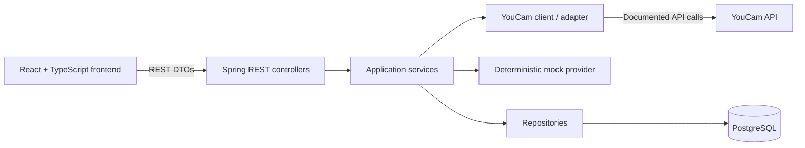

# Technical Architecture

## Goals and constraints

The system supports a React skincare storefront backed by Spring Boot REST APIs and PostgreSQL. The backend owns business rules, persistence, and all communication with YouCam. The frontend never contains the YouCam API key.

YouCam request and response structures are intentionally not described here. They must come from the official API documentation before the adapter is implemented.

## Component view

The diagram describes intended boundaries, not implemented components. Provider selection will use backend configuration, including `YOUCAM_MOCK=true` for deterministic local and test behavior without a YouCam call.

## Backend responsibilities

- **Controller:** Expose REST endpoints, validate request DTOs, call services, and translate results into response DTOs. Controllers do not contain recommendation or provider-specific logic.
- **Service:** Orchestrate use cases, enforce business rules, and coordinate repositories and the provider port. Keep provider details out of the service's internal domain model.
- **YouCam client/adapter:** Encapsulate authentication, HTTP communication, provider-specific request/response models, and mapping to internal domain types. Implement only against supplied official documentation.
- **Mock provider:** Return deterministic analysis and/or simulation data for development and tests without network calls or API credit use.
- **Repository:** Persist application-owned data through PostgreSQL. Repository models remain separate from REST DTOs and provider models.
- **Global exception handling:** Convert expected validation, application, and integration failures into a consistent API error format without exposing secrets or sensitive data.

Use constructor dependency injection. Keep classes focused and introduce abstractions only where they isolate a real boundary, such as the provider adapter or persistence.

## Frontend responsibilities

The React and TypeScript application handles the user journey, form and upload interactions, and display of analysis, routines, product recommendations, and simulation comparisons. Axios calls the backend REST API. The frontend receives only the backend API URL as configuration; provider credentials remain on the server.

The exact frontend routes and REST endpoint paths are deferred until the internal API contracts are designed.

## Intended request flow

1. The user submits an image through the frontend to a backend endpoint.
2. A controller validates the request and passes an application DTO to a service.
3. The service invokes the configured analysis provider boundary. In mock mode it receives deterministic data; in real mode the adapter maps internal inputs to documented YouCam requests.
4. The service maps analysis output into internal concerns and coordinates any persistence or recommendation work.
5. The backend returns response DTOs for the frontend to display.
6. A later simulation use case follows the same service-to-provider boundary, then returns a result for the before-and-after view.

Steps describe the planned flow; upload transport, synchronous versus asynchronous processing, and persistence details remain open until requirements are confirmed.

## Data and privacy boundaries

PostgreSQL is the planned relational store for application-owned data. The schema and product catalog source are not defined yet. Raw selfie and simulation storage must not be assumed: decide consent, storage location, access control, retention, and deletion requirements before implementing it. Never log image content, image URLs that grant access, API keys, or unnecessary personal data.

## Configuration boundaries

Configuration is supplied through environment variables or an approved secret store. `.env.example` documents proposed variable names with safe placeholders. The exact YouCam base URL, authentication scheme, endpoints, payloads, and limits must be derived from official documentation and configured only on the backend.
