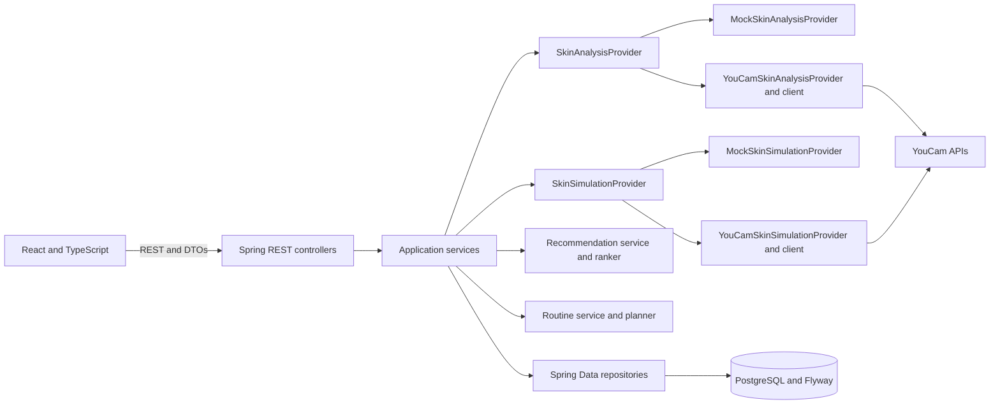

# Technical Architecture

## Overview

SkinCart AI is a browser application backed by Spring Boot REST APIs and PostgreSQL. The backend owns validation, analysis orchestration, recommendation and routine logic, persistence, and all YouCam communication. The React frontend communicates only with SkinCart endpoints.

## Component architecture

The main backend packages are under `com.skincart`: `controller`, `service`, `provider`, `provider.youcam`, `dto`, `recommendation`, `routine`, `repository`, `entity`, and `simulation`.

## Frontend to backend flow

The frontend uses Axios with `VITE_API_BASE_URL` and calls:

- `POST /api/v1/skin-analysis` with multipart field `image`.
- `GET /api/v1/skin-analysis/{analysisId}` to read analysis state and results.
- `GET /api/v1/skin-analysis/{analysisId}/recommendations` for ranked demo-catalog products.
- `GET /api/v1/skin-analysis/{analysisId}/routine` for the AM/PM routine.
- `POST /api/v1/skin-analysis/{analysisId}/simulation` with a `concernCode`.

Controllers validate request DTOs and delegate to services. Services own orchestration and persistence; controllers do not contain provider or recommendation rules.

## Skin Analysis and YouCam

`SkinAnalysisService` validates the uploaded image, creates the analysis record, submits it to the configured `SkinAnalysisProvider`, and persists the resulting status and supported concern data. The YouCam implementation is isolated in `YouCamSkinAnalysisProvider` and `provider.youcam` clients and DTOs.

In real mode, the backend handles YouCam file upload, task creation, and task-status polling. The provider task is asynchronous, while `SkinAnalysisService` performs bounded polling within the upload request before returning. Polling uses a configurable interval (10 seconds by default) and no more than six attempts. The backend maps documented provider fields into SkinCart result models; provider-specific DTOs do not become frontend contracts.

When `YOUCAM_MOCK=true`, `MockSkinAnalysisProvider` returns deterministic analysis data without contacting YouCam.

## Recommendation and routine engines

The recommendation service reads persisted concern results and products from the demo catalog. `ProductRecommendationRanker` deterministically ranks products using concern, ingredient, catalog, and category matches. The catalog is seeded by Flyway; it is demo data, not retailer inventory or availability.

The routine service passes ranked products to `RoutinePlanner`, which assembles the AM and PM routine. Both features use existing backend data and do not call YouCam.

## Skin Simulation

`SkinSimulationService` validates the analysis and requested concern, then delegates through `SkinSimulationProvider`. In real mode, `YouCamSkinSimulationProvider` and its client submit and poll the YouCam simulation task within the simulation request. In mock mode, `MockSkinSimulationProvider` returns deterministic preview data without an external call. The frontend presents the returned simulation alongside the selected original image.

## PostgreSQL persistence

Spring Data repositories persist analysis state and concern results and read the demo product, ingredient, and concern catalog. Flyway manages schema and catalog migrations; Hibernate validates the mapped schema at startup.

## Task and polling flow

Analysis and simulation are asynchronous tasks at the provider boundary. The backend submits each task, polls for a terminal provider status within the corresponding service request, maps success or failure into SkinCart state, and persists the outcome. Poll interval and attempt limit are configurable through `YOUCAM_POLL_INTERVAL` and `YOUCAM_MAX_POLL_ATTEMPTS`; the default interval is 10 seconds and the limit is six attempts. The frontend reads the SkinCart analysis resource rather than communicating with YouCam.

## Security and configuration boundaries

- `YOUCAM_API_KEY` and YouCam authentication belong to the backend. The frontend receives only the SkinCart API base URL.
- YouCam request/response models and file/task operations stay inside the backend adapter.
- Signed upload URLs, authorization data, image bytes, and sensitive provider responses must not be exposed to the browser or written to logs.
- Database connection, server port, CORS origin, upload limits, provider mode, and polling settings are configured through backend properties and environment variables.
- `YOUCAM_MOCK=true` selects deterministic mock providers; use it for development and tests that must make no real YouCam calls.
- Upload validation and consistent API error mapping are handled by backend services and global exception handling.
